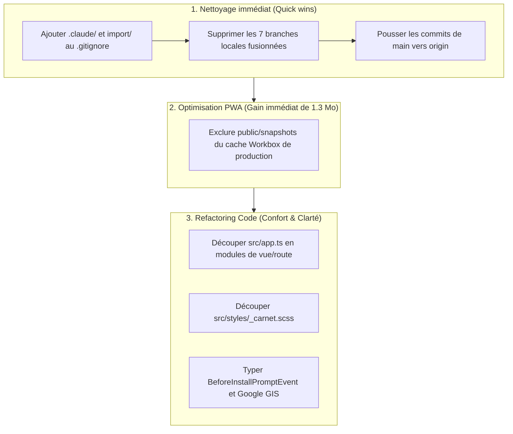

# Inventaire de la dette technique et des éléments résiduels (debt.md)

Ce document dresse l'état des lieux complet de ce qui « traîne » ou nécessite un nettoyage/refactorisation dans le projet `multiplication`.

---

## 1. Fichiers et dossiers non suivis (Untracked & Artefacts locaux)

| Élément | Emplacement | Taille / Poids | Description & Action recommandée |
|---|---|---|---|
| **Images sources brutes** | [`import/`](file:///home/marcgardent/multiplication/import/) | ~17,2 Mo | Contient 4 fichiers JPEG haute résolution (`city-cyberpunk.jpeg`, `city-steampunk.jpeg`, `city-superheroes.jpeg`, `village-gaulois.jpeg`). Ce sont les sources des fonds WebP convertis dans `public/backgrounds/`. **Action :** Supprimer le dossier ou l'archiver hors du dépôt / ajouter à `.gitignore`. |
| **Configuration Claude locale** | [`.claude/`](file:///home/marcgardent/multiplication/.claude/) | ~1 Ko | Fichiers `launch.json` et `settings.local.json` non suivis. **Action :** Ajouter `.claude/` dans [`.gitignore`](file:///home/marcgardent/multiplication/.gitignore). |
| **Dossier de configuration IDE** | `.idea/` | ~1 Ko | Fichiers d'environnement IDE (JetBrains/WebStorm). **Action :** Ajouter `.idea/` dans [`.gitignore`](file:///home/marcgardent/multiplication/.gitignore). |
| **Modèle vocal neuronal** | [`scripts/.voices/`](file:///home/marcgardent/multiplication/scripts/.voices/) | ~61 Mo | Modèle Piper ONNX (`fr_FR-siwis-medium.onnx`) et son JSON téléchargés par `make audio`. **État :** Bien ignoré dans `.gitignore`, mais pèse lourd sur le disque de travail si non utilisé fréquemment. |
| **Artefacts de build** | `dist/` | ~6 Mo | Généré par `npm run build` / `make build`. Bien ignoré par `.gitignore`. |

---

## 2. Dette Git (Branches résiduelles & Commits non poussés)

### Commits locaux non publiés
* La branche `main` locale a **4 commits d'avance** sur `origin/main` (non poussés sur GitHub) :
  1. `8fe3eaf` - *feat: citation orale et affichage systématique de la bonne réponse en mode évaluation*
  2. `e559cd8` - *feat: affichage transparent des files d'attente (queues) en révision guidée*
  3. `0e44c47` - *feat: ajout du bouton '?' (je ne sais pas) sur la calculette*
  4. `74efdcc` - *feat: mémorisation et fusion cloud de la sélection des tables par contexte (profil, brossage, radio)*

### Branches locales fusionnées (Merged branches)
Ces branches ont toutes été intégrées à `main` et ne sont plus utiles :
* `bouton-retour`
* `espace-parent`
* `presentation-et-pages-legales`
* `radio-et-brossage`
* `refonte-da-et-repetition-espacee`
* `testabilite-scenarios`
* `verification-google`

> **Commande de nettoyage :** `git branch -d bouton-retour espace-parent presentation-et-pages-legales radio-et-brossage refonte-da-et-repetition-espacee testabilite-scenarios verification-google`

### Branches distantes orphelines sur `origin`
* `origin/bouton-retour`, `origin/espace-parent`, etc. existent encore sur le dépôt GitHub distant malgré la fusion de leurs Pull Requests.

---

## 3. Architecture & Modularité du code

### Monolithe `src/app.ts` (1 009 lignes)
* [`src/app.ts`](file:///home/marcgardent/multiplication/src/app.ts) concentre trop de rôles disparates :
  * Routage des vues (`currentTab`: home, carnet, snapshots).
  * Shell applicatif (header, points, mute, install PWA).
  * Gestionnaire d'écrans de session guidée (écoute, pratique, bilan).
  * Contrôleur de modales (tables, récompenses, Drive).
* **Piste d'amélioration :** Extraire le routeur d'écrans, la gestion du shell et les modales de session dans des modules dédiés (`src/shell/`, `src/routes/`).

### Styles CSS volumineux dans `_carnet.scss`
* [`src/styles/_carnet.scss`](file:///home/marcgardent/multiplication/src/styles/_carnet.scss) dépasse 890 lignes.
* Il combine la grille 10x10, la modale de détail d'un calcul, la carte des KPIs parents et la nouvelle carte d'ordonnancement des tables.
* **Piste d'amélioration :** Séparer en `_matrix_grid.scss`, `_matrix_modal.scss` et `_learning_order.scss`.

### Typage `any` résiduel
* [`src/services/googleDriveService.ts:34`](file:///home/marcgardent/multiplication/src/services/googleDriveService.ts#L34) : `google?: any;` pour l'API Google Identity Services (GIS).
* [`src/app.ts:111`](file:///home/marcgardent/multiplication/src/app.ts#L111) : `let deferredInstallPrompt: any = null;` pour l'événement `BeforeInstallPromptEvent`.

---

## 4. Code hérité (Compatibilité ascendante & Migrations)

* **Migration d'avant la Boîte 5** :
  Dans [`src/core/matrixStore.ts:137-139`](file:///home/marcgardent/multiplication/src/core/matrixStore.ts#L137-L139), le code vérifie encore si un calcul stocké possède l'ancienne propriété `legacy.bestBoxLevel >= 2` pour lui attribuer le cadeau.
* **Appareil hérité dans les sauvegardes** :
  Dans [`src/services/cloudMerge.ts:25`](file:///home/marcgardent/multiplication/src/services/cloudMerge.ts#L25), `LEGACY_DEVICE = "legacy"` est conservé pour attribuer les points des anciens fichiers Drive qui ne comportaient pas de trace vectorielle d'appareil.
* **Distinction de deux constantes de tables par défaut** :
  * `DEFAULT_TABLES = [2, 3]` dans `tableSelectionModal.ts` (sélection initiale pour révision libre/évaluation/radio).
  * `DEFAULT_LEARNING_TABLES = [1, 10, 2, 5, 3, 4, 6, 7, 8, 9]` dans `matrixStore.ts` (ordre par défaut de progression guidée).
  * Les rôles sont distincts mais méritent d'être explicités pour éviter toute confusion.

---

## 5. Performance, Assets & Cache PWA

### Snapshots de test embarqués en production
* Le dossier [`public/snapshots/`](file:///home/marcgardent/multiplication/public/snapshots/) contient 18 fichiers JSON (~1,3 Mo) générés pour la simulation et la CI (`make scenarios`).
* Ces fichiers sont copiés dans `dist/snapshots/` et **pré-cachés par le Service Worker** (`workbox`) pour tous les utilisateurs réels en production, alors qu'ils ne sont accessibles que par l'utilisateur fictif `@test-ci`.
* **Piste d'amélioration :** Exclure `snapshots/*.json` du glob `globPatterns` de `vite-plugin-pwa` dans [`vite.config.ts`](file:///home/marcgardent/multiplication/vite.config.ts) pour économiser ~1,3 Mo de téléchargement initial.

---

## 6. Dépendances & Chaîne de build

### Dépendances npm majeures disponibles
* `typescript` : `5.9.3` $\rightarrow$ `7.x` disponible.
* `vite` : `6.4.4` $\rightarrow$ `8.x` disponible.
* `vite-plugin-pwa` : `0.21.2` $\rightarrow$ `2.0.0` disponible.
* *(Note : 0 vulnérabilité de sécurité détectée via `npm audit`)*.

### Outillage hors-Node.js
* `scripts/generate_audio.py` dépend de `uv`, Python, Piper et `ffmpeg`. Ces prérequis ne sont pas vérifiés ni installés automatiquement par `npm install` (nécessitent l'environnement système documenté dans le README).

---

## 7. Plan d'actions préconisé

