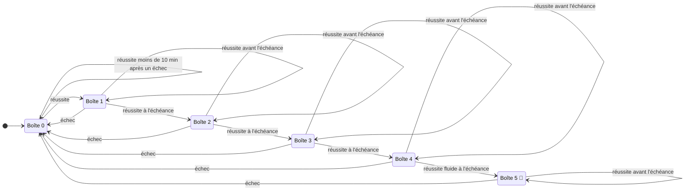
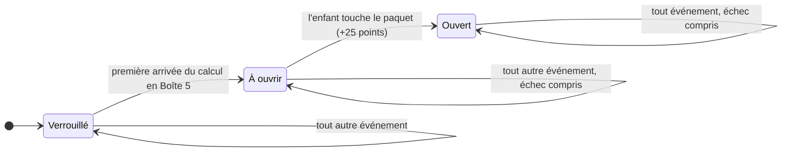

# Progression d'un calcul et récompenses

Ce document est la référence des règles. Le code les applique dans [`src/core/matrixStore.ts`](../src/core/matrixStore.ts) et chaque flèche du graphe a son test dans [`src/core/repetition.test.ts`](../src/core/repetition.test.ts). Pour changer une règle : modifier ce document d'abord, puis le code et les tests.

## Les boîtes

Chacun des 100 calculs est rangé dans une boîte, de **Boîte 0** à **Boîte 5**. C'est le champ `boxLevel` du code.

**J0** désigne le jour où le calcul est réussi pour la première fois.

| Code | Nom complet | Attente avant de pouvoir monter | Jour d'arrivée, sans échec ni retard |
|---|---|---|---|
| Boîte 0 | À apprendre : jamais vu, seulement écouté, ou raté | aucune ; 10 minutes après un échec | |
| Boîte 1 | Réussi une première fois | 1 jour | J0 |
| Boîte 2 | Réussi à J1 | 2 jours | J1 |
| Boîte 3 | Réussi à J3 | 4 jours | J3 |
| Boîte 4 | Réussi à J7 | 14 jours | J7 |
| Boîte 5 | Maîtrisé, cadeau gagné 🎁 | 21 jours, révision d'entretien | **J21** |

Les révisions tombent donc à **J1, J3, J7 et J21**. Le cadeau se gagne le 21e jour.

## Graphe à états



## Table de transitions

Chaque case donne la boîte d'arrivée et la nouvelle échéance. « Inchangée » veut dire que rien ne bouge, ni la boîte ni l'échéance.

| Boîte de départ | Écoute | Réussite à l'échéance | Réussite avant l'échéance | Échec |
|---|---|---|---|---|
| Boîte 0 | Boîte 0, échu tout de suite | **Boîte 1**, lendemain | Boîte 0, inchangée (moins de 10 min après un échec) | Boîte 0, dans 10 min |
| Boîte 1 | inchangée | **Boîte 2**, dans 2 jours | inchangée | **Boîte 0**, dans 10 min |
| Boîte 2 | inchangée | **Boîte 3**, dans 4 jours | inchangée | **Boîte 0**, dans 10 min |
| Boîte 3 | inchangée | **Boîte 4**, dans 14 jours | inchangée | **Boîte 0**, dans 10 min |
| Boîte 4 | inchangée | fluide : **Boîte 5**, dans 21 jours, cadeau gagné. Lente : Boîte 4, lendemain | inchangée | **Boîte 0**, dans 10 min |
| Boîte 5 | inchangée | Boîte 5, dans 21 jours | inchangée | **Boîte 0**, dans 10 min |

Précisions :

- **À l'échéance** veut dire le jour prévu ou après. Les échéances en jours tombent à minuit : la séance compte à n'importe quelle heure du jour prévu.
- **Avant l'échéance**, une réussite entraîne et rapporte des points, mais ne fait pas monter. C'est ce qui empêche de gagner plusieurs boîtes dans la même séance.
- **Un échec renvoie toujours en Boîte 0**, depuis n'importe quelle boîte, même avant l'échéance. Le calendrier repart alors du début : le calcul revient 10 minutes plus tard, et il faudra de nouveau J1, J3, J7 et J21.
- **Temps de réponse** : de la question à l'appui sur Valider, moins 0,5 seconde accordée pour cet appui. À la voix, de la question à la fin du dernier mot prononcé (si Valider est touché avant que la reconnaissance ait fini la phrase : au moment où le nombre entendu a changé pour la dernière fois), même si Valider est touché après : ni le temps que met la reconnaissance à comprendre, ni l'attente avant Valider ne sont comptés, et rien n'est retiré. Si l'enfant corrige ensuite au clavier, c'est de nouveau l'appui sur Valider qui compte, moins 0,5 seconde. C'est ce temps qui compte pour la réponse fluide, le bonus de rapidité et l'échelle de vitesse du carnet.
- **Réponse fluide** : en 3,8 secondes au plus. Elle n'est exigée que pour entrer en Boîte 5. Une réussite lente ce jour-là ne fait pas perdre 14 jours : le calcul revient le lendemain.
- En Boîte 0, un calcul jamais écouté peut monter directement en Boîte 1 par une réussite, par exemple en « Révision tables ».
- Les attentes sont fixes : la vitesse de réponse ne les allonge ni ne les raccourcit.
- Un enfant en retard ne perd rien : s'il fait la révision de J3 à J5, la suivante est 4 jours plus tard, à J9.

## Répondre à la voix

Avant chaque séance (révision guidée ou révision des tables), l'enfant choisit comment il joue. Son dernier choix est déjà coché.

| Choix | Son | Réponse |
|---|---|---|
| 🤫 En silence | aucun | au clavier |
| 🔊 Avec le son | questions, réponses, félicitations | au clavier |
| 🎤 Je parle | questions, réponses, félicitations | à voix haute |

- Pendant le jeu, deux icônes en haut de l'écran changent le son (🔊 / 🔇) et la façon de répondre (🎤 à la voix, ⌨️ au clavier). Elles sont aussi sur l'écran d'accueil. Le choix est propre à l'appareil : la sauvegarde ne le recopie pas sur les autres.
- À la voix, le micro attend la fin de la question : la voix de l'application n'est pas prise pour une réponse. Une ligne au-dessus du clavier dit à l'enfant où il en est : « Je prépare mes oreilles… », « Écoute la question… », « Dis la réponse, puis appuie sur Valider. », « Je t'entends… » dès qu'il parle, « J'ai compris 56 : appuie sur Valider. », « Je n'ai pas compris. Redis la réponse. », « Attends… ». Tant que rien n'est entendu, un micro occupe la case de la réponse dans le grand calcul : il respire quand c'est à l'enfant, et un anneau grandit avec sa voix pendant qu'il parle. Il voit tout de suite qu'il est entendu, là où la réponse va s'écrire.
- Le clavier reste affiché. Un nombre dit s'écrit dans la réponse comme s'il avait été tapé, dès qu'il est entendu, sans attendre la fin de la phrase ; l'enfant le confirme avec Valider, ou le redit, ou le corrige au clavier. Mêmes règles, mêmes points qu'au clavier. « Fois » et « égal » sont compris pour que l'enfant puisse répéter la question. Si l'enfant se reprend (« cinquante… cinquante-six »), c'est le dernier nombre qui compte. S'il répète la question (« sept fois huit, cinquante-six »), la question n'est pas prise pour la réponse.
- La reconnaissance ne choisit que parmi une liste fermée : les nombres de 0 à 100, « passe », « je passe », « suivant », « réponse », « la réponse », « je ne sais pas », « je sais pas ». Tout le reste est entendu comme un mot inconnu. Toute la liste des nombres, pas seulement la bonne réponse : sinon une mauvaise réponse proche (« trente-cinq » pour 36) serait recollée sur la bonne et comptée juste (6 cas sur 42 à l'essai).
- Un nombre dont la fin n'est pas comprise (« vingt… » puis un mot inconnu) n'est pas deviné : l'enfant redit sa réponse.
- L'essai de l'espace parent affiche, pour chaque réponse, la supposition qui a servi.
- « Je passe », « réponse » ou « je ne sais pas » font la même chose que le bouton « Je ne sais pas » (« Donner la réponse » dans le Quiz) : la réponse est donnée et le calcul compte comme un échec.
- Si le micro est refusé ou ne marche pas, l'enfant revient au clavier, avec un message qui le lui dit.
- La réponse à voix haute est désactivée par défaut : un parent l'active dans l'espace parent, et cette activation télécharge le modèle vocal. Le réglage est partagé par la sauvegarde : un autre appareil où elle est activée télécharge le modèle tout seul. Tant qu'elle est désactivée, « Je parle » et 🎤 restent visibles mais grisés, avec « À activer dans l'espace parent ». Une famille qui avait déjà utilisé la voix en 1.7.0 la garde activée.
- La voix est reconnue sur l'appareil par Vosk (petit modèle français, 42 Mo, licence Apache 2.0) : rien ne part sur internet. Le modèle est téléchargé depuis le site une seule fois, au premier « Je parle » ou depuis l'espace parent, puis gardé par le navigateur. La reconnaissance du navigateur (Google pour Chrome) a été essayée d'abord : elle ne rendait rien pour un nombre dit seul, trop court pour elle.
- **Bouton à maintenir**, la façon d'écouter par défaut : l'enfant appuie, dit la réponse, relâche. 0,4 s de son avant l'appui et 0,3 s après le relâchement sont gardées, pour ne couper ni le début ni la fin ; un appui de moins de 0,25 s ne compte pas (« Trop court »). Le bouton est rouge tant qu'il est enfoncé. Une réponse dite sans appuyer n'est pas prise. Le parent peut choisir à la place, pour ce téléphone, le repérage automatique de la parole décrit ci-dessous (« Plus d'options ») ; si le test du téléphone l'a trouvé praticable ou non conseillé, ce choix est présenté comme déconseillé.
- En repérage automatique, seule la parole est donnée à Vosk, découpée en phrases : une phrase commence quand le volume dépasse nettement le bruit de la pièce (au moins 0,08 s), garde 0,3 s de son d'avant, et se ferme après 0,4 s de silence ou 6 s au plus. Sans ce découpage, un téléphone lent prenait du retard pendant les silences et ne le rattrapait jamais. C'est une heuristique : une voix trop faible dans une pièce bruyante peut ne pas être entendue. Entre la fin de la phrase et le nombre compris, l'enfant voit « ⏳ Je réfléchis… » ; sans résultat après 8 s, « Je n'ai pas compris ».
- **Test du téléphone** (espace parent, propre à chaque appareil, non recopié par la sauvegarde). Il se lance tout seul quand le parent active la réponse à voix haute, et peut être refait. Pensé pour n'importe quel adulte, sans chiffres : 1. « Installation » la première fois, puis « Préparation » (un loader, le temps de charger la reconnaissance, pour que ce chargement ne compte pas dans l'attente) ; 2. « Faites silence 10 secondes » : 🤫 en grand et une barre de 10 s, pour mesurer le bruit de la pièce ; 3. trois nombres (7, 56, 81), « Maintenez le bouton et prononcez 7 » : on maintient le bouton du nombre en le disant ; il devient 🎤, puis ⏳, puis s'affiche en vert (compris) ou en rouge (on peut redire). Le bilan est une jauge de 5 niveaux, d'une seule couleur (verte, orange ou rouge selon le résultat), d'après l'attente entre le relâchement et le nombre compris : **Conseillé** (niveaux 5 et 4 : jusqu'à 1 s, 5 jusqu'à 0,6 s), **Praticable** (niveau 3 : jusqu'à 2,5 s ; « Je parle » prévient que c'est un peu lent), **Non conseillé** (niveau 2 : plus lent ; niveau 1 : moins de deux nombres sur trois compris, ou micro qui ne marche pas ; « Je parle » est grisé avec la raison). Le test fixe aussi le seuil de la parole pour le repérage automatique (à mi-chemin, en volume perçu, entre le bruit et la voix). Ces seuils sont des choix de confort pour un enfant, à revoir avec l'usage.

## Quels calculs entrent dans une séance

Une révision guidée travaille un lot de calculs choisi au départ et figé pour toute la séance.

| Durée | Calculs au plus | dont nouveaux au plus |
|---|---|---|
| 3 minutes | 6 | 2 |
| 6 minutes | 10 | 4 |
| 9 minutes | 14 | 6 |
| 15 minutes | 18 | 8 |

Les révisions échues passent avant les nouveaux calculs. Quand il y en a plus que de places, elles entrent dans cet ordre :

1. les calculs en **Boîte 4** : leur révision du 21e jour donne le cadeau, elle ne doit jamais être repoussée ;
2. les calculs ratés ;
3. les boîtes les plus basses d'abord, puis l'échéance la plus ancienne.

Les révisions qui ne rentrent pas attendent la séance suivante. Tant qu'elles remplissent le lot, aucun nouveau calcul n'est proposé.

### Ordre d'apprentissage des nouveaux calculs

Quand des places sont disponibles pour de nouveaux calculs, l'algorithme pioche dans **l'ordre des tables défini dans le carnet de suivi** (par défaut `1, 10, 2, 5, 3, 4, 6, 7, 8, 9`, réorganisable par le parent) :

1. L'algorithme pioche les calculs non abordés (`unknown`) de la première table de la liste (ex. `2 × 1`, `2 × 2`...).
2. Dès que tous les calculs d'une table ont été introduits, il passe à la table suivante dans la liste.
3. Si une séance a besoin de nouveaux calculs alors qu'une table est presque finie, le reste est pris au début de la table suivante.
4. Les tables retirées de la liste (mises en réserve / en pause) ne sont pas piochées : aucun calcul n'en est introduit tant qu'elles ne sont pas réactivées.
5. Lorsque toutes les tables actives ont été découvertes, aucun nouveau calcul n'entre tant que de nouvelles tables ne sont pas ajoutées.

## Cadeau

Chaque calcul a un cadeau. Son état ne revient jamais en arrière.



- Le cadeau est **définitif**. Un échec renvoie le calcul en Boîte 0 mais ne touche pas au cadeau, qu'il soit déjà ouvert ou non.
- Dans le code : champ `giftEarned` du calcul, mis à vrai à l'arrivée en Boîte 5 et jamais remis à faux ; liste `opened_gifts` pour les cadeaux ouverts.
- Les cadeaux gagnés avec l'ancienne règle (dès la Boîte 2) restent acquis.

## Points et décors

| Événement | Points |
|---|---|
| Écoute d'un calcul | +5 |
| Bonne réponse | +10 |
| Bonne réponse en moins de 2,5 secondes | +5 de plus |
| Arrivée en Boîte 5 | +50 de plus |
| Ouverture d'un cadeau | +25 |
| Roue magique, 3 tours par jour | le résultat du calcul tiré, de 1 à 100 |

La radio des tables et le brossage de dents ne donnent aucun point et ne déplacent aucun calcul d'une boîte à l'autre, même en mode guidé : écouter ne prouve pas que l'enfant sait.

Un décor est débloqué dès que le total de points atteint son seuil. Les points ne baissent jamais, donc un décor débloqué le reste.

Les seuils sont réglés pour s'étaler sur tout le parcours d'une élève régulière qui joue **6 minutes par jour** (environ 650 points par jour) : un premier décor dès le lendemain, puis des attentes de plus en plus longues, le dernier vers le 100e jour, quand presque tous les cadeaux sont gagnés. Les jours ci-dessous viennent de la simulation (`make scenarios`), une séance par jour.

| Décor | Seuil | 3 min par jour | **6 min par jour** | 9 min par jour | 15 min par jour, élève rapide |
|---|---|---|---|---|---|
| Printemps | 0 | J0 | **J0** | J0 | J0 |
| Été | 1 000 | J3 | **J1** | J1 | J0 |
| Hiver | 2 500 | J8 | **J4** | J2 | J0 |
| Automne | 4 500 | J14 | **J7** | J5 | J1 |
| Pâques | 7 000 | J21 | **J11** | J7 | J2 |
| Halloween | 10 000 | J29 | **J16** | J11 | J3 |
| Noël | 13 500 | J38 | **J21** | J14 | J4 |
| Monde Plateforme | 18 000 | J49 | **J27** | J19 | J6 |
| Monde Fermier | 23 500 | J63 | **J35** | J24 | J7 |
| Monde Voxel | 30 000 | J80 | **J44** | J30 | J10 |
| Village Gaulois | 38 000 | J102 | **J55** | J38 | J12 |
| Ville des Super-Héros | 47 000 | J127 | **J68** | J46 | J15 |
| Ville Steampunk | 58 000 | J156 | **J83** | J56 | J19 |
| Ville Cyberpunk | 72 000 | J196 | **J104** | J70 | J23 |

Les points gagnés sont proportionnels au temps joué : un enfant qui joue plus longtemps chaque jour débloque les décors plus vite.

Les décors débloqués avec les anciens seuils (500 à 22 000 points pour dix décors) restent acquis aux joueurs qui les avaient.

## Radio et brossage de dents

### Deux façons de choisir les calculs

Un appui sur 📻 ou 🪥 ouvre une fenêtre à deux onglets :

- **🎯 Guidé** : on coche un ou plusieurs joueurs, et l'écoute reprend ce qu'ils ont à revoir. Le brossage se fait souvent à plusieurs : les calculs utiles à plusieurs enfants passent devant.
- **✋ Manuel** : on coche des tables, comme avant ; tous leurs calculs forment le pool.

Chaque mode, radio et brossage, retient sur l'appareil son dernier onglet et ses derniers joueurs cochés ; les tables cochées suivent la règle des réglages. Sans aucun joueur, seul l'onglet Manuel est proposé.

### Le pool en mode guidé

Pour chaque joueur coché, chaque calcul reçoit un rang. Ses données sont seulement lues, jamais modifiées.

| Situation du calcul pour ce joueur | Rang |
|---|---|
| Raté, à reprendre | 1 |
| Révision échue, quelle que soit la boîte | 2 |
| En cours d'apprentissage (Boîte 0 déjà vu, Boîte 1 ou 2), pas encore échu | 3 |
| Les 2 prochains nouveaux calculs de son ordre du carnet de suivi | 3 |
| Boîte 3 à 5, pas encore échu | hors du pool |
| Pas encore abordé, au-delà des 2 prochains | hors du pool |

- Un calcul prend le meilleur rang qu'il a chez l'un des joueurs.
- À rang égal, le calcul concerné par le plus de joueurs passe devant.
- À égalité complète, les calculs qui n'ont pas été entendus à la dernière écoute passent devant, puis le hasard décide.
- Moins de 6 calculs dans le pool : il est complété par les calculs de Boîte 3 à 5 les plus proches de leur échéance. S'il reste vide, la fenêtre l'annonce et propose l'onglet Manuel.

Exemple : Léa a raté 7 × 8 ; Tom a sa révision de 7 × 8 échue et 6 × 4 en Boîte 1. Le pool commence par 7 × 8 (rang 1, deux joueurs), puis 6 × 4 (rang 3, un joueur).

En mode manuel, le pool est mélangé au hasard, et les calculs entendus à la dernière écoute passent à la fin.

### Répétition espacée pendant l'écoute

Un calcul dure environ 5,5 secondes : question, temps de réflexion, réponse et courte pause. L'écoute est une suite de créneaux, environ 32 pour les 3 minutes d'un brossage.

1. Sur un créneau libre, le calcul suivant du pool entre : il est dit une première fois, puis repris **3, 6 et 12 calculs plus tard** (environ 15 secondes, 30 secondes et 1 minute). Une reprise qui tombe sur un créneau déjà pris glisse au suivant libre.
2. Un calcul n'entre que si au moins ses deux premières reprises tiennent avant la fin. Les créneaux restants servent à réentendre le calcul entendu il y a le plus longtemps.
3. Le même calcul ne passe jamais deux fois de suite, sauf si le pool n'en compte qu'un.

Exemple, un brossage avec les tables de 2 et 3 (chaque lettre est un calcul) :

```
A B C A B C D E F A B C D E F A B C D E F A B C F A B C F A D E
```

Six calculs entrent, chacun entendu 4 à 7 fois. Les quatorze autres attendent le brossage suivant, qui commence par eux.

La radio ne finit pas : les reprises continuent d'un morceau à l'autre, et quand tout le pool est entré, un nouveau tour recommence dans un autre ordre.

## Vérifier ces règles sans attendre 21 jours

- `make test` rejoue chaque flèche du graphe.
- `make scenarios` fait vivre des élèves simulés sur plusieurs semaines et enregistre leur état aux moments clés dans `public/snapshots/`.
- Dans l'application, le joueur nommé `@test-ci` a un bouton « Scénarios de test » qui charge ces états : veille du cadeau, cadeaux à ouvrir, décor sur le point d'être débloqué, etc.
