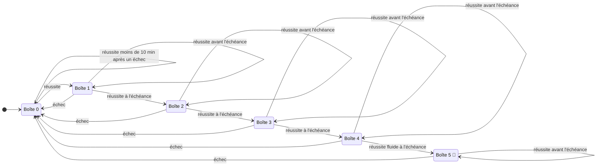
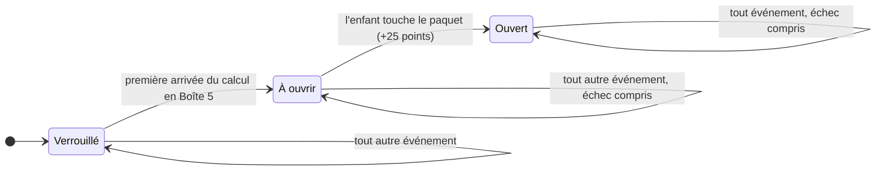

# Progression d'un calcul et récompenses

Ce document est la référence des règles. Le code les applique dans [`src/core/matrixStore.ts`](../src/core/matrixStore.ts) et chaque flèche du graphe a son test dans [`src/core/repetition.test.ts`](../src/core/repetition.test.ts). Pour changer une règle : modifier ce document d'abord, puis le code et les tests.

## Les boîtes

Chacun des 100 calculs est rangé dans une boîte, de **Boîte 0** à **Boîte 5**. C'est le champ `boxLevel` du code.

**J0** désigne le jour où le calcul est réussi pour la première fois.

| Code | Nom complet | Attente avant de pouvoir monter | Jour d'arrivée, sans échec ni retard |
|---|---|---|---|
| Boîte 0 | À apprendre : jamais vu, seulement écouté, ou raté | aucune ; 10 minutes après un échec | |
| Boîte 1 | Réussi une première fois | 1 jour | J0 |
| Boîte 2 | Réussi à J1 | 2 jours | J1 |
| Boîte 3 | Réussi à J3 | 4 jours | J3 |
| Boîte 4 | Réussi à J7 | 14 jours | J7 |
| Boîte 5 | Maîtrisé, cadeau gagné 🎁 | 21 jours, révision d'entretien | **J21** |

Les révisions tombent donc à **J1, J3, J7 et J21**. Le cadeau se gagne le 21e jour.

## Graphe à états

## Table de transitions

Chaque case donne la boîte d'arrivée et la nouvelle échéance. « Inchangée » veut dire que rien ne bouge, ni la boîte ni l'échéance.

| Boîte de départ | Écoute | Réussite à l'échéance | Réussite avant l'échéance | Échec |
|---|---|---|---|---|
| Boîte 0 | Boîte 0, échu tout de suite | **Boîte 1**, lendemain | Boîte 0, inchangée (moins de 10 min après un échec) | Boîte 0, dans 10 min |
| Boîte 1 | inchangée | **Boîte 2**, dans 2 jours | inchangée | **Boîte 0**, dans 10 min |
| Boîte 2 | inchangée | **Boîte 3**, dans 4 jours | inchangée | **Boîte 0**, dans 10 min |
| Boîte 3 | inchangée | **Boîte 4**, dans 14 jours | inchangée | **Boîte 0**, dans 10 min |
| Boîte 4 | inchangée | fluide : **Boîte 5**, dans 21 jours, cadeau gagné. Lente : Boîte 4, lendemain | inchangée | **Boîte 0**, dans 10 min |
| Boîte 5 | inchangée | Boîte 5, dans 21 jours | inchangée | **Boîte 0**, dans 10 min |

Précisions :

- **À l'échéance** veut dire le jour prévu ou après. Les échéances en jours tombent à minuit : la séance compte à n'importe quelle heure du jour prévu.
- **Avant l'échéance**, une réussite entraîne et rapporte des points, mais ne fait pas monter. C'est ce qui empêche de gagner plusieurs boîtes dans la même séance.
- **Un échec renvoie toujours en Boîte 0**, depuis n'importe quelle boîte, même avant l'échéance. Le calendrier repart alors du début : le calcul revient 10 minutes plus tard, et il faudra de nouveau J1, J3, J7 et J21.
- **Réponse fluide** : en 3,8 secondes au plus. Elle n'est exigée que pour entrer en Boîte 5. Une réussite lente ce jour-là ne fait pas perdre 14 jours : le calcul revient le lendemain.
- En Boîte 0, un calcul jamais écouté peut monter directement en Boîte 1 par une réussite, par exemple en « Révision tables ».
- Les attentes sont fixes : la vitesse de réponse ne les allonge ni ne les raccourcit.
- Un enfant en retard ne perd rien : s'il fait la révision de J3 à J5, la suivante est 4 jours plus tard, à J9.

## Quels calculs entrent dans une séance

Une révision guidée travaille un lot de calculs choisi au départ et figé pour toute la séance.

| Durée | Calculs au plus | dont nouveaux au plus |
|---|---|---|
| 3 minutes | 6 | 2 |
| 6 minutes | 10 | 4 |
| 9 minutes | 14 | 6 |
| 15 minutes | 18 | 8 |

Les révisions échues passent avant les nouveaux calculs. Quand il y en a plus que de places, elles entrent dans cet ordre :

1. les calculs en **Boîte 4** : leur révision du 21e jour donne le cadeau, elle ne doit jamais être repoussée ;
2. les calculs ratés ;
3. les boîtes les plus basses d'abord, puis l'échéance la plus ancienne.

Les révisions qui ne rentrent pas attendent la séance suivante. Tant qu'elles remplissent le lot, aucun nouveau calcul n'est proposé.

### Ordre d'apprentissage des nouveaux calculs

Quand des places sont disponibles pour de nouveaux calculs, l'algorithme pioche dans **l'ordre des tables défini dans le carnet de suivi** (par défaut `1, 10, 2, 5, 3, 4, 6, 7, 8, 9`, réorganisable par le parent) :

1. L'algorithme pioche les calculs non abordés (`unknown`) de la première table de la liste (ex. `2 × 1`, `2 × 2`...).
2. Dès que tous les calculs d'une table ont été introduits, il passe à la table suivante dans la liste.
3. Si une séance a besoin de nouveaux calculs alors qu'une table est presque finie, le reste est pris au début de la table suivante.
4. Les tables retirées de la liste (mises en réserve / en pause) ne sont pas piochées : aucun calcul n'en est introduit tant qu'elles ne sont pas réactivées.
5. Lorsque toutes les tables actives ont été découvertes, aucun nouveau calcul n'entre tant que de nouvelles tables ne sont pas ajoutées.

## Cadeau

Chaque calcul a un cadeau. Son état ne revient jamais en arrière.

- Le cadeau est **définitif**. Un échec renvoie le calcul en Boîte 0 mais ne touche pas au cadeau, qu'il soit déjà ouvert ou non.
- Dans le code : champ `giftEarned` du calcul, mis à vrai à l'arrivée en Boîte 5 et jamais remis à faux ; liste `opened_gifts` pour les cadeaux ouverts.
- Les cadeaux gagnés avec l'ancienne règle (dès la Boîte 2) restent acquis.

## Points et décors

| Événement | Points |
|---|---|
| Écoute d'un calcul | +5 |
| Bonne réponse | +10 |
| Bonne réponse en moins de 2,5 secondes | +5 de plus |
| Arrivée en Boîte 5 | +50 de plus |
| Ouverture d'un cadeau | +25 |
| Roue magique, 3 tours par jour | le résultat du calcul tiré, de 1 à 100 |

La radio des tables et le brossage de dents se lancent sans joueur : ils ne donnent aucun point et ne déplacent aucun calcul d'une boîte à l'autre.

Un décor est débloqué dès que le total de points atteint son seuil. Les points ne baissent jamais, donc un décor débloqué le reste.

Les seuils sont réglés pour s'étaler sur tout le parcours d'une élève régulière qui joue **6 minutes par jour** (environ 650 points par jour) : un premier décor dès le lendemain, puis des attentes de plus en plus longues, le dernier vers le 100e jour, quand presque tous les cadeaux sont gagnés. Les jours ci-dessous viennent de la simulation (`make scenarios`), une séance par jour.

| Décor | Seuil | 3 min par jour | **6 min par jour** | 9 min par jour | 15 min par jour, élève rapide |
|---|---|---|---|---|---|
| Printemps | 0 | J0 | **J0** | J0 | J0 |
| Été | 1 000 | J3 | **J1** | J1 | J0 |
| Hiver | 2 500 | J8 | **J4** | J2 | J0 |
| Automne | 4 500 | J14 | **J7** | J5 | J1 |
| Pâques | 7 000 | J21 | **J11** | J7 | J2 |
| Halloween | 10 000 | J29 | **J16** | J11 | J3 |
| Noël | 13 500 | J38 | **J21** | J14 | J4 |
| Monde Plateforme | 18 000 | J49 | **J27** | J19 | J6 |
| Monde Fermier | 23 500 | J63 | **J35** | J24 | J7 |
| Monde Voxel | 30 000 | J80 | **J44** | J30 | J10 |
| Village Gaulois | 38 000 | J102 | **J55** | J38 | J12 |
| Ville des Super-Héros | 47 000 | J127 | **J68** | J46 | J15 |
| Ville Steampunk | 58 000 | J156 | **J83** | J56 | J19 |
| Ville Cyberpunk | 72 000 | J196 | **J104** | J70 | J23 |

Les points gagnés sont proportionnels au temps joué : un enfant qui joue plus longtemps chaque jour débloque les décors plus vite.

Les décors débloqués avec les anciens seuils (500 à 22 000 points pour dix décors) restent acquis aux joueurs qui les avaient.

## Vérifier ces règles sans attendre 21 jours

- `make test` rejoue chaque flèche du graphe.
- `make scenarios` fait vivre des élèves simulés sur plusieurs semaines et enregistre leur état aux moments clés dans `public/snapshots/`.
- Dans l'application, le joueur nommé `@test-ci` a un bouton « Scénarios de test » qui charge ces états : veille du cadeau, cadeaux à ouvrir, décor sur le point d'être débloqué, etc.
