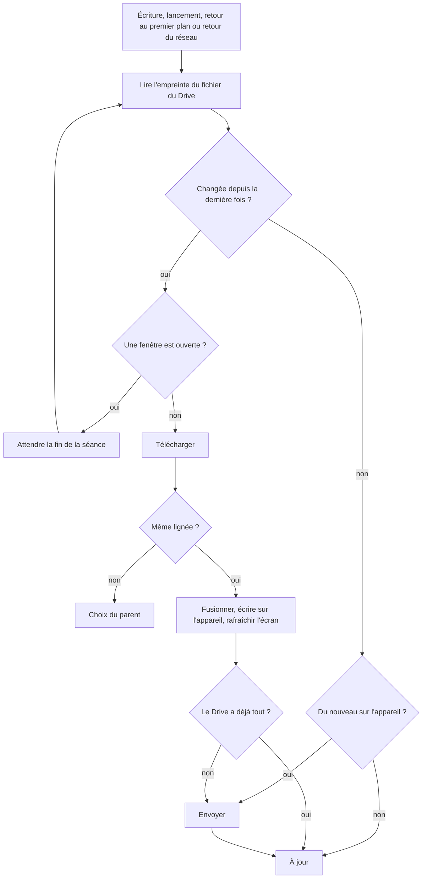

# Sauvegarde automatique et fusion entre appareils

Ce document est la référence des règles de fusion. Le code les applique dans [`src/services/cloudMerge.ts`](../src/services/cloudMerge.ts) et chaque ligne du tableau a son test dans [`src/services/cloudMerge.test.ts`](../src/services/cloudMerge.test.ts). Pour changer une règle : modifier ce document d'abord, puis le code et les tests.

## Le problème

La sauvegarde est un seul fichier dans le Google Drive du parent. Deux appareils peuvent avancer chacun de leur côté, hors ligne, puis envoyer leur version. Aucune des deux ne doit être perdue, et le parent ne doit rien avoir à décider.

## Pas de verrou

Google Drive ne sait pas écrire « seulement si personne n'a écrit depuis », ni créer un fichier « seulement s'il n'existe pas ». Un verrou posé dans le Drive resterait donc une course entre appareils.

À la place, la fusion est faite pour que **l'ordre et les répétitions n'aient aucun effet** : fusionner A puis B, B puis A, ou deux fois le même fichier donne le même résultat. Si deux appareils écrivent au même moment, le second écrase le fichier du premier, mais rien n'est perdu : les données du premier sont toujours sur son appareil. À sa synchronisation suivante il voit que le fichier a changé, et refusionne.

Limite assumée : un appareil écrasé dans cette fenêtre d'environ une seconde, et qui ne se reconnecte plus jamais, garde ses derniers progrès pour lui.

## Règles de fusion

| Donnée | Règle | Exemple |
|---|---|---|
| Liste des joueurs | réunion, par identifiant | Léa créée sur A, Tom sur B : Léa et Tom |
| Points, temps d'entraînement | somme des progrès de chaque appareil | 1000 au départ, +200 sur A, +300 sur B : 1500 |
| État d'un calcul : boîte, échéance, statistiques | celui de l'appareil qui a travaillé ce calcul en dernier | échec lundi sur A, réussite mardi sur B : état de B |
| Cadeau gagné | gagné sur un appareil, gagné partout ; jamais repris | |
| Cadeaux ouverts, décors conservés | réunion | |
| Historique des réponses | réunion sans doublon, les 500 plus récentes | |
| Roue du jour | le jour le plus récent ; le même jour, le plus grand nombre de tours utilisés | |
| Réglages : durée de séance, tables de la radio et du brossage, décor choisi | le plus récemment modifié | |
| Joueur connecté, dernier scénario de test | propre à chaque appareil, jamais fusionné | |

Conséquences acceptées :

- Un même cadeau ouvert sur deux appareils hors ligne rapporte deux fois ses 25 points. Il en va de même du bonus de maîtrise d'un calcul. Les points ne baissent jamais.
- La roue peut avoir été tournée 3 fois sur chaque appareil le même jour.
- Pour un calcul travaillé des deux côtés, les réponses données sur l'appareil qui n'a pas le dernier mot restent dans l'historique mais ne comptent plus dans sa boîte.

## La somme sans double compte

Pour chaque compteur, le fichier garde **la part apportée par chaque appareil**, par exemple `{ appareilA: 700, appareilB: 800 }`. Le total est leur somme. Chaque appareil ne fait monter que sa propre part. À la fusion on prend, pour chaque appareil, la plus grande part connue : fusionner deux fois le même fichier n'ajoute donc rien.

Sur l'appareil, rien ne change de forme : `points_<joueur>` reste un nombre. La répartition par appareil vit dans le fichier de sauvegarde (bloc `sync`) et dans les réglages de synchronisation.

**Premier contact** entre un appareil et une sauvegarde qu'il ne connaît pas, comme à l'activation sur un deuxième téléphone ou devant un ancien fichier sans répartition : on garde le plus grand des deux totaux, jamais leur somme.

## Lignée : quand le parent garde la main

Trois actions remplacent volontairement les données d'un appareil :

- « Importer une sauvegarde » depuis un fichier ;
- le chargement d'un scénario par le joueur `@test-ci` ;
- « Garder cet appareil » dans la fenêtre de sauvegarde.

Chacune ouvre une nouvelle **lignée**, un identifiant aléatoire écrit dans le fichier, et remplace la sauvegarde du Drive sans fusion. Un autre appareil qui découvre une lignée différente de la sienne ne fusionne pas : il affiche le choix « Reprendre la sauvegarde du Drive » ou « Garder cet appareil ». C'est le seul cas où le parent est sollicité.

Un fichier sans bloc `sync` (sauvegarde d'avant la fusion) est traité de la même façon par un appareil qui a déjà une lignée, et fusionné selon la règle du premier contact par un appareil qui n'en a pas.

## Déroulé d'une synchronisation

- La fusion n'est jamais écrite pendant une séance, la radio ou le brossage : elle attend un écran calme.
- Entre la lecture des données de l'appareil et l'écriture du résultat, rien ne peut s'intercaler : aucune réponse de l'enfant n'est perdue.
- Un marqueur « fusion en cours » est posé avant l'écriture et retiré après. S'il est retrouvé au lancement, l'application a été tuée au mauvais moment : on ne fusionne pas à l'aveugle, le parent choisit.

## Vérifier ces règles

`make test` rejoue chaque ligne du tableau, vérifie sur des cas tirés au hasard que la fusion ne dépend ni de l'ordre ni des répétitions, et fait vivre deux appareils sur un faux Drive partagé : hors ligne chacun de son côté, écritures simultanées, activation sur un second appareil, changement de lignée.
